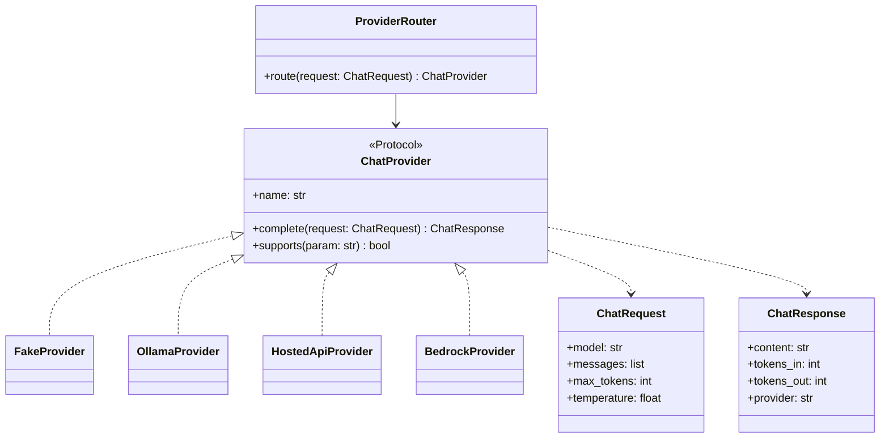

# Modelos

## Modelo de datos

Las keys se guardan hasheadas, nunca en claro. En DynamoDB puede ir en una sola tabla con PK/SK;
aquí se muestran las entidades lógicas.

```mermaid
erDiagram
    TEAM ||--o{ API_KEY : tiene
    TEAM ||--|| BUDGET : tiene
    TEAM ||--o{ USAGE_MONTH : acumula
    TEAM ||--o{ USAGE_EVENT : genera

    TEAM {
        string team_id PK
        string name
        string status
    }
    API_KEY {
        string key_hash PK
        string team_id FK
        string prefix
        datetime created_at
        datetime revoked_at
    }
    BUDGET {
        string team_id PK
        decimal monthly_limit_usd
        int requests_per_minute
    }
    USAGE_MONTH {
        string team_id PK
        string month SK
        int tokens_in
        int tokens_out
        decimal cost_usd
    }
    USAGE_EVENT {
        string request_id PK
        string team_id
        string model
        int latency_ms
        decimal cost_usd
        datetime ts
    }
```

## Patrón de adaptadores de proveedor

El núcleo solo conoce el contrato. En Python el contrato puede ser un `Protocol`
(tipado estructural: no exige herencia, a diferencia de una `interface` de Java).


